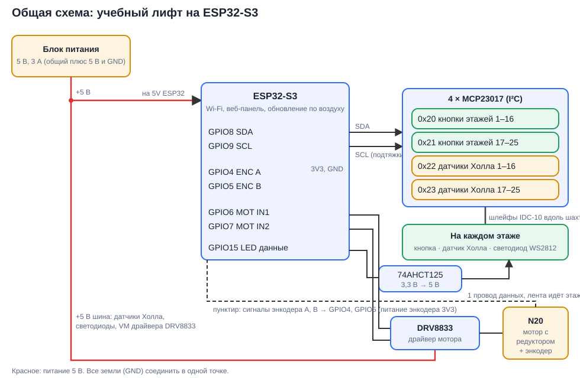

# LIFT — a desktop elevator model you can program, break and fix

**English** · [Русский](README.ru.md)

An educational working model of an elevator for kids (and curious adults): up to **25 floors**, a printed shaft, a cabin with a counterweight, one call button and one "call accepted" LED on every floor, a Hall sensor on every floor, and a **Wi‑Fi web panel** that shows what the elevator is thinking and lets you change how it behaves. Built around an **ESP32‑S3**, programmed in the **Arduino IDE**, no cloud, no app, no account.

It was designed for two children (4 and 9 years old) who play with it on their own: press a button, watch the LED light up, watch the cabin come. The 9‑year‑old can open the panel, switch the dispatching rule, slow everything down, "break" a sensor and see how the elevator reacts.

> The web panel and the user manual in `docs/` are in Russian. Translations are welcome (see [Contributing](#contributing)).

```
 phone / tablet ──Wi‑Fi──►  ESP32‑S3  ──I²C──► 2…4 × MCP23017 ──► buttons, Hall sensors (per floor)
   web panel                    │
   (or browser simulator)       ├──PWM──► DRV8833 ──► N20 gear motor (+ encoder, optional)
                                └──1 wire──► 74AHCT125 ──► WS2812 LED chain (per floor)
```



---

## Contents

1. [Features](#features)
2. [How the elevator decides where to go](#how-the-elevator-decides-where-to-go)
3. [What you need](#what-you-need)
4. [Repository layout](#repository-layout)
5. [Quick start](#quick-start)
6. [Wiring](#wiring)
7. [The web panel](#the-web-panel)
8. [Settings reference](#settings-reference)
9. [Safety and fault handling](#safety-and-fault-handling)
10. [Motor without an encoder](#motor-without-an-encoder)
11. [Development](#development)
12. [Project status](#project-status)
13. [Contributing](#contributing)
14. [License](#license)

---

## Features

### The elevator itself
* **Up to 25 floors**, 100 mm floor pitch, 80 × 80 mm shaft made of stackable printed sections (one identical section per floor).
* **One button and one LED per floor.** The LED is orange while a call is waiting ("call accepted"), green where the cabin is standing, and shows other states (see [LED colours](#led-colours)).
* **A Hall sensor on every floor** (A3144) sees a magnet on the cabin. The firmware uses it to find the first floor, to calibrate the floor positions and to correct the position while driving.
* **Three dispatching rules**, switchable from the panel (see [below](#how-the-elevator-decides-where-to-go)): "collective down", "first come first served", "collective both ways".
* **Priority floors** (optional): calls from chosen floors are served first.
* **Home floor (parking):** hold a floor button for 5 s (or long‑press it in the panel) to make it the home floor; after a configurable idle time the elevator drives home by itself.
* **Smooth motion:** trapezoidal speed profile with separate acceleration, deceleration, approach speed and approach distance, all adjustable from 5 mm/s² and 1 mm/s.
* **Automatic calibration:** the elevator drives to the top, records where every sensor sits and measures its own speed/encoder scale.
* **Works with or without a motor encoder.** Without it the position is estimated from motor power and time and the cabin is stopped by the Hall sensors; see [Motor without an encoder](#motor-without-an-encoder).
* **Night mode:** manual (quieter, slower, dimmer) and a schedule that dims the LEDs between two times. The clock comes from the browser or from NTP.
* **Fault handling instead of crashing:** every failure stops the motor, blinks all LEDs red and explains the problem in plain language (see [Safety and fault handling](#safety-and-fault-handling)).

### The web panel
* Served by the ESP32 itself, works on a phone, tablet or laptop, **no internet needed**.
* **2D shaft view** with the moving cabin, the call buttons with their LED state, Hall sensor dots and the queue of waiting calls.
* **"What is happening inside"**: current floor, target, speed, height, encoder counts, motor power and the active rule, plus a plain‑language sentence explaining *why* the elevator is doing what it does.
* Tabs: **Play**, **Settings**, **Calibration**, **Service**.
* **Learning toys:** *"Show me"* (the elevator calls itself), slow motion, and **simulated sensor fault** (pick a floor whose sensor "breaks" and watch what the elevator reports).
* **Installation helpers:** one‑click motor test, per‑floor *button and LED test* (press a real button → its LED turns white and the tile lights up; tap a tile → that floor's LED blinks), a chase test over all LEDs, a live table of Hall sensors.
* **Browser simulator:** open `web/dist/index.html` from disk and you get the same panel driving a virtual elevator. No hardware needed.
* **Over‑the‑air updates:** upload a `.bin` in the panel (or use Arduino OTA).
* **Network:** the elevator always runs its own access point `LIFT-Setup` (password set from the panel and stored on the controller, captive portal included), and can join your home Wi‑Fi (`lift.local` via mDNS, IP shown in the panel).
* Settings are stored in the ESP32 flash and survive updates and power loss.

### LED colours
| Colour | Meaning |
|---|---|
| orange | call accepted, waiting |
| green | the cabin is on this floor |
| dim blue | home (parking) floor |
| blue on floor 1 | looking for the first floor |
| cyan | calibration in progress |
| red blinking (all) | fault |
| white | button currently pressed (test mode) |
| violet blinking | "find this LED" (test mode) |

---

## How the elevator decides where to go

The dispatcher is a small pure function (`plan()`), implemented twice and kept identical: in JavaScript (`web/src/dispatcher.js`, used by the simulator and the unit tests) and in C++ (`firmware/lift/dispatcher.h`).

| Rule | Behaviour |
|---|---|
| **Collective down** (default) | The **first caller is served first.** Going up, the elevator drives without stopping to the *oldest* waiting call above it; going down, it stops at every call on the way. Newer calls above the current target wait their turn. Example: calls 5, 4, 3, 2 pressed on floor 1 → up to 5, then down stopping at 4, 3, 2. First 10 then 5 → 10 first. First 5 then 10 → 5 first. |
| **First come first served** | Strictly in the order of the presses. |
| **Collective both ways** | Picks up everyone on the way in the current direction, nearest first, then reverses. |

Other rules: a call on the floor where the cabin stands is served immediately; a call the cabin can no longer brake for is postponed; the current target is never "forgotten", even if the estimated position overshoots it slightly; priority floors (if enabled) are served before everything else.

---

## What you need

Details and search keywords: [`docs/shopping-list.md`](docs/shopping-list.md) (Russian), wiring: [`docs/wiring.md`](docs/wiring.md).

### Electronics (for N floors, N ≤ 25)
| Part | Qty | Notes |
|---|---|---|
| ESP32‑S3 DevKitC‑1 (or any ESP32‑S3 board with GPIO4–9, 11, 15 free) | 1 | |
| N20 gear motor, 6 V, 100–200 rpm, 3 mm D‑shaft; with magnetic encoder preferred | 1 (+1 spare) | works without encoder in a reduced‑accuracy mode |
| DRV8833 motor driver module | 1 | |
| MCP23017 I²C expander modules (GY‑MCP23017) | 2 for N ≤ 16, otherwise 4 | addresses 0x20–0x23 |
| 74AHCT125 (or 74HCT245) level shifter | 1 | 3.3 V → 5 V for the LED data line |
| A3144 Hall sensor (TO‑92) | N | digital, open collector. **Not** latching types |
| Neodymium magnet 8 × 3 mm | 1 (+spares) | on the cabin, south pole to the sensor |
| WS2812 5 mm through‑hole LED ("F5") | N | |
| Push button, hole Ø7 mm, normally open | N | |
| 4.7 kΩ resistor networks (SIP‑10) / resistors, 470 Ω, 100 nF caps, 1000 µF and 100 µF electrolytics | see shopping list | pull‑ups, decoupling |
| 5 V / 3 A power supply | 1 | |
| 10‑wire ribbon cable + IDC‑10 connectors | 3 × shaft height × 2 | one ribbon per 8 floors for buttons and for sensors |

### Mechanics
* **3D‑printed parts**, PETG, 0.4 mm nozzle, 0.2 mm layers (printed on a Bambu A1). Sources in [`3d-model/`](3d-model/): STL for printing, STEP for FreeCAD, and the CadQuery scripts that generate them (`params.py` holds every dimension).

| Part | Qty |
|---|---|
| `1_dno_shakhty` – shaft bottom with stops | 1 |
| `2_section_etazh` – one section = one floor, with door opening, landing, button/LED panel and diamond windows for the sensors | N |
| `3_potolok_s_otverstiyami` – ceiling with two Ø4 holes for the rope | 1 |
| `4a_kronshtein_motor_N20` + `5a_shkiv_na_val_motora` – motor bracket and V‑groove pulley (Ø42 mm) on the motor shaft | 1 + 1 |
| `4b` / `5b` – variant without motor: pulley on an M3 axle | optional |
| `6_cabin_kabina` – cabin (no doors) | 1 |
| `7_counterweight_protivoves` – counterweight with a pocket for ballast (nuts, coins, steel plate) | 1 |

* Nylon thread (~1 mm) or similar as the rope: cabin → ceiling hole → pulley → ceiling hole → counterweight. Friction guides, no rollers.
* Tools: soldering iron, multimeter, wire cutters, heat‑shrink.

> The very first thing to buy: **3 Hall sensors, 2–3 magnets, one button, one LED**, and test one printed section: the Hall sensor must trigger through the diamond window at about 12 mm. Then buy the rest.

---

## Repository layout

| Path | What is it |
|---|---|
| `firmware/lift/` | Arduino sketch. Open `lift.ino`. |
| `firmware/lift/lift_ctrl.h` | the elevator: state machine, homing, calibration, motion, LEDs, buttons |
| `firmware/lift/dispatcher.h` | "where to go" rules (C++ port of `web/src/dispatcher.js`) |
| `firmware/lift/hardware.h` | encoder ISR, MCP23017, DRV8833, WS2812 |
| `firmware/lift/web_server.h` | Wi‑Fi, HTTP API, OTA |
| `firmware/lift/config.h` | pins, settings, flash storage |
| `firmware/lift/webpage.h` | generated: the web panel, gzipped, embedded in the firmware |
| `web/src/` | web panel sources (HTML, CSS, JS) and the browser simulator |
| `web/dist/index.html` | built panel, open it in a browser to try the simulator |
| `tools/build.js` | builds `web/dist/index.html` and `firmware/lift/webpage.h` |
| `tools/make-schematic.js` | generates the printable wiring schematic |
| `tests/` | dispatcher unit tests (`node --test tests/dispatcher.test.js`) |
| `3d-model/` | STL / STEP models and CadQuery source |
| `docs/` | Russian user manual (`README.md`), wiring, shopping list, printable schematic (`schematic.pdf`, 6 × A4) |

---

## Quick start

### 1. Try it without hardware
Open `web/dist/index.html` in a browser. It starts a simulated elevator with the full panel.

### 2. Flash the firmware
1. Arduino IDE 2.x. Board manager: **esp32 by Espressif, version 3.x** (tested with 3.3.8).
2. Library manager: **Adafruit NeoPixel** 1.12.4 or newer (tested with 1.15.5). No other libraries are required.
3. Board settings that were tested: *ESP32S3 Dev Module*, Flash Mode *QIO 80MHz*, Flash Size *4MB*, Partition Scheme *Default 4MB with spiffs*, PSRAM *Disabled*, USB CDC On Boot *Disabled*, Upload Speed *921600*.
4. Open `firmware/lift/lift.ino`, connect the board, **Upload**.

The web panel is already embedded in `webpage.h`. Node.js is only needed if you change something in `web/src` (then run `node tools/build.js` first).

Later updates can be uploaded over the air: *Sketch → Export compiled binary*, then *Service → Firmware update* in the panel.

### 3. First connection
1. The elevator opens a Wi‑Fi network **`LIFT-Setup`** (open at first). Join it and browse to `http://192.168.4.1`.
2. **Set a password for the access point right away:** *Settings → Network → LIFT‑Setup password* (8–63 characters). It is stored separately and is not erased by the factory reset.
3. Optionally enter your home Wi‑Fi name and password and press *Save and connect*. The panel then shows the elevator's address in your network; `LIFT-Setup` stays as a fallback.

### 4. Bring‑up order (what to check, in which order)
1. **Expanders.** The log (*Service → Log*) must not complain about MCP23017. If it does, it names the missing addresses and lists the ones found on the bus.
2. **Motor.** *Service → Motor test* spins the motor for 1 s in each direction (without the cabin on the thread). Wrong direction: tick *Invert motor*.
3. **Buttons and LEDs.** *Calibration → Button and LED test*: press a real button, its LED lights white; tap a tile, that floor's LED blinks violet; "Run over all" chases through every LED. The red dot in a tile means the Hall sensor sees the magnet.
4. **First floor.** *Calibration → Find floor 1.*
5. **Calibration.** Add floors one by one, check every sensor, then press *Calibrate*.

---

## Wiring

Full description with tables, ribbon cable pinouts and a printable schematic: [`docs/wiring.md`](docs/wiring.md) and [`docs/schematic.pdf`](docs/schematic.pdf).

### ESP32‑S3 pins
| Function | GPIO |
|---|---|
| I²C SDA / SCL (to the MCP23017 modules) | 8 / 9 |
| Encoder A / B (powered from 3V3) | 4 / 5 |
| DRV8833 IN1 / IN2 | 6 / 7 |
| WS2812 data (through the 74AHCT125 and a 470 Ω resistor) | 15 |
| Emergency stop button, optional (to GND, enable `HAVE_ESTOP` in `config.h`) | 11 |

### I²C expanders
| Module | Address | Jumpers | Function |
|---|---|---|---|
| 1 | 0x20 | – | buttons, floors 1–16 |
| 2 | 0x21 | A0 | buttons, floors 17–25 |
| 3 | 0x22 | A1 | Hall sensors, floors 1–16 |
| 4 | 0x23 | A0 + A1 | Hall sensors, floors 17–25 |

Up to 16 floors need only modules 1 and 3.

### Power
One 5 V / 3 A supply feeds the ESP32 (5V pin), the DRV8833 (VM), the Hall sensor rail and the LEDs. **Join all grounds in one point.** The N20 motor is rated for 6 V and runs a little slower on 5 V, which is fine. Keep the LED brightness reasonable (40 % by default): at full brightness 25 LEDs draw up to about 1.5 A.

---

## The web panel

| Tab | Purpose |
|---|---|
| **Play** | 2D shaft, call buttons (tap = call, hold = set home floor), queue, live readouts, plain‑language status, fault card, quick buttons (*Show me*, *Slow down*) |
| **Settings** | all settings, grouped (see below) |
| **Calibration** | find floor 1, calibrate, Stop, button/LED test, Hall sensor table with the detected centres of the floors |
| **Service** | log, OTA update, motor test, factory reset, reboot |

### HTTP API (for tinkerers)
| Endpoint | |
|---|---|
| `GET /api/state` | everything the panel shows (position, state, calls, sensors, faults, clock) |
| `GET /api/config`, `POST /api/config` | settings (JSON) |
| `POST /api/call?f=<floor index>` | call the elevator |
| `POST /api/cmd?name=<home\|stop\|clear\|calibrate\|park\|reset\|motortest\|ledtest\|iotest\|wifi\|reboot>&arg=<n>` | commands |
| `POST /api/time?t=<unix seconds>&tz=<minutes>` | set the clock (the panel does this automatically) |
| `GET /api/log` | log |
| `POST /update` | firmware upload |

---

## Settings reference

**Elevator:** number of floors, dispatching rule, door time (dwell), night mode.
**Speed:** maximum speed, acceleration (5–1000 mm/s²), deceleration (5–1000 mm/s²), approach speed (1–60 mm/s), approach distance (1–50 mm).
**Home floor:** enable, floor, idle time before driving home, how long to hold a button to set it.
**Priority:** enable, which floors.
**Lighting:** brightness, scheduled night dimming (start, end, night brightness), clock status.
**Demo modes:** the elevator calls itself, slow motion, simulated sensor fault on a floor.
**Hardware (for adults):** floor pitch, Hall zone width, encoder pulses per mm, *encoder present*, open‑loop gain, start power, run power (no‑encoder mode), invert motor / encoder / Hall sensors, speed controller P and I.
**Network:** host name, home Wi‑Fi name and password, access point password.

---

## Safety and fault handling

The elevator never keeps driving when it does not understand the situation. It stops the motor, blinks all LEDs red and shows a message. *Try again* in the panel clears the fault and searches for floor 1 again.

| Message (translated) | Cause |
|---|---|
| No MCP23017 with address …; found on the bus … | wiring, power or address jumpers of an expander |
| No communication with the expanders (I²C) | the bus failed while running |
| Emergency stop pressed | optional e‑stop button, or the panel's Stop |
| No sensor fired, the cabin is not moving or does not see the magnet | **watchdog:** while searching for floor 1 or calibrating, no Hall sensor changed state for longer than the expected travel time (cabin against the stop, thread slipping, broken sensor or wire, motor direction). The motor is stopped so it is not pushed against the stop |
| Could not find the first floor / calibration: top sensor not found | the cabin travelled farther than the whole shaft |
| Calibration: no signal from the sensor of floor N | missing or weak magnet |
| Do not see the sensor on floor N | the cabin arrived (or passed) and the sensor did not report |
| Lost count of floors | thread slipping, position error > 0.45 floor |
| Cabin does not move, maybe stuck / moving the wrong way | *(with encoder)* wrong motor/encoder polarity or a jam |

---

## Motor without an encoder

If you only have a plain N20 gear motor (no encoder), untick *Encoder present* in *Settings → Hardware*.

* The position is integrated from the commanded speed; **the cabin is stopped by the Hall sensor** of the target floor. Until it fires, the elevator creeps at approach speed.
* *Calibrate* (at least 3 floors) measures the real speed from the time between sensors and tunes the *power per mm/s* coefficient.
* Gear motors do not start at low power. **Start power** (default 30 %) is applied for the first 0.35 s; afterwards **run power** may be lower, which gives a slower, softer approach. Tune both in *Settings → Hardware*.
* The DRV8833 is driven in *slow‑decay* mode, so the motor voltage is proportional to the duty cycle even at low power.
* Accuracy is lower than with an encoder. When the encoder motor arrives, connect it, tick *Encoder present* and run *Calibrate* again.

---

## Development

```bash
node tools/build.js                      # web/src → web/dist/index.html + firmware/lift/webpage.h
node --test tests/dispatcher.test.js     # dispatcher unit tests
node tools/make-schematic.js             # docs/schematic.html (print to PDF from a browser)
```

* **Architecture.** The control loop runs in its own FreeRTOS task on core 1 (5 ms tick): it reads the expanders, updates the position, handles buttons, runs the state machine (homing → idle → moving → dwell, calibration, fault) and drives the motor and the LEDs. The Wi‑Fi/HTTP server runs on the Arduino loop and talks to the controller only through a command queue and a mutex‑protected copy of the settings.
* **Encoder interrupt** is placed in IRAM and reads the GPIO register directly, so it is safe while the flash is busy (Wi‑Fi, NVS).
* **The dispatcher is duplicated** (JS and C++): change both and the tests.
* Settings that were added later live in their own flash namespaces (`liftsec`, `liftmot`, `liftnight`) so that updating the firmware never wipes the Wi‑Fi credentials.
* **Regenerating the 3D models:** `pip install cadquery`, then `cd 3d-model && python3 cq_model.py <floors>`. Every dimension is in `3d-model/params.py`.

---

## Project status

Verified on the author's prototype (5 floors, N20 motor **without** encoder, ESP32‑S3, two MCP23017):
* the firmware builds, boots and runs; Wi‑Fi access point, home Wi‑Fi, password, OTA and the web panel work on phones;
* motor drive, homing against the Hall sensors, calibration without an encoder, floor‑to‑floor travel, buttons and the fault watchdog;
* dispatcher: 20 unit tests plus the browser simulator.

Not yet field‑tested: the encoder (closed‑loop) mode, the speed controller tuning, more than 5 floors, the 3rd and 4th expander, the optional emergency stop.

The panel and `docs/` are in Russian only.

---

## Contributing

Issues and pull requests are welcome, especially:
* translating the panel (all texts are in `web/src/app.js`, `web/src/index.template.html` and the log messages in `firmware/lift/`) and `docs/`;
* photos and videos of builds;
* field reports with other motors, sensors and cabin variants;
* a 7‑segment floor indicator (TM1637 is in the optional parts list, not implemented).

Please run `node --test tests/dispatcher.test.js` before sending a PR and keep the JS and C++ dispatchers in sync.

## License

* **Code and firmware** (`firmware/`, `web/`, `tools/`, `tests/`, `3d-model/*.py`): [MIT](LICENSE).
* **3D models and documentation** (`3d-model/STL_*`, `3d-model/STEP_*`, `docs/`, this README): [CC BY‑SA 4.0](https://creativecommons.org/licenses/by-sa/4.0/). See [LICENSES.md](LICENSES.md).

Developed with the help of Claude (Anthropic).
