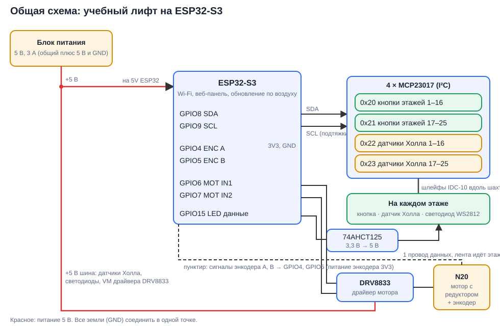

# LIFT — настольная модель лифта, которую можно программировать, ломать и чинить

[English](README.md) · **Русский**

Учебная действующая модель лифта для детей (и любопытных взрослых): до **25 этажей**, печатная шахта, кабина с противовесом, на каждом этаже одна кнопка вызова и светодиод «вызов принят», датчик Холла на каждом этаже и **веб-панель по Wi‑Fi**, которая показывает, что «думает» лифт, и позволяет менять его поведение. Построен на **ESP32‑S3**, программируется в **Arduino IDE**, без облаков, приложений и аккаунтов.

Сделан для двух детей (4 и 9 лет), которые играют с ним сами: нажал кнопку, увидел, что светодиод загорелся, дождался кабины. Девятилетний может открыть панель, переключить правило работы, замедлить всё, «сломать» датчик и посмотреть, как лифт на это отреагирует.

> Веб-панель и руководство в `docs/` только на русском. Переводы на другие языки приветствуются (см. [Участие](#участие)).

```
 телефон / планшет ──Wi‑Fi──►  ESP32‑S3  ──I²C──► 2…4 × MCP23017 ──► кнопки, датчики Холла (по этажам)
   веб-панель                      │
   (или симулятор в браузере)      ├──ШИМ──► DRV8833 ──► мотор N20 (+ энкодер, по желанию)
                                   └──1 провод──► 74AHCT125 ──► цепочка WS2812 (по этажам)
```



---

## Содержание

1. [Возможности](#возможности)
2. [Как лифт решает, куда ехать](#как-лифт-решает-куда-ехать)
3. [Что понадобится](#что-понадобится)
4. [Состав репозитория](#состав-репозитория)
5. [Быстрый старт](#быстрый-старт)
6. [Подключение](#подключение)
7. [Веб-панель](#веб-панель)
8. [Справочник настроек](#справочник-настроек)
9. [Безопасность и обработка ошибок](#безопасность-и-обработка-ошибок)
10. [Мотор без энкодера](#мотор-без-энкодера)
11. [Разработка](#разработка)
12. [Состояние проекта](#состояние-проекта)
13. [Участие](#участие)
14. [Лицензия](#лицензия)

---

## Возможности

### Сам лифт
* **До 25 этажей**, шаг этажа 100 мм, шахта 80 × 80 мм из печатных секций, которые вставляются друг в друга (одна одинаковая секция на этаж).
* **Одна кнопка и один светодиод на этаж.** Светодиод оранжевый, пока вызов ждёт («вызов принят»), зелёный там, где стоит кабина, и показывает другие состояния ([цвета светодиодов](#цвета-светодиодов)).
* **Датчик Холла на каждом этаже** (A3144) замечает магнит на кабине. По нему прошивка находит первый этаж, калибрует положения этажей и поправляет положение на ходу.
* **Три правила работы**, переключаются в панели ([ниже](#как-лифт-решает-куда-ехать)): «попутный вниз», «по очереди», «попутный в обе стороны».
* **Приоритетные этажи** (по желанию): их вызовы обслуживаются первыми.
* **Дом лифта (парковка):** держите кнопку этажа 5 секунд (или долго нажмите на неё в панели), и этот этаж станет домом. После заданного времени простоя лифт сам едет домой.
* **Плавное движение:** трапециевидный профиль скорости с отдельными настройками разгона, торможения, скорости и пути подхода. Разгон настраивается от 5 мм/с², скорость подхода от 1 мм/с.
* **Автоматическая калибровка:** лифт едет вверх до конца, запоминает, где стоит каждый датчик, и измеряет свою скорость и масштаб энкодера.
* **Работает с энкодером и без него.** Без энкодера положение оценивается по мощности мотора и времени, а кабину останавливают датчики Холла ([Мотор без энкодера](#мотор-без-энкодера)).
* **Ночной режим:** ручной (тише, медленнее, тусклее) и по расписанию (светодиоды тускнеют между двумя временами). Время берётся из браузера или из интернета (NTP).
* **Ошибки вместо поломок:** при любой неисправности мотор останавливается, светодиоды мигают красным, а в панели понятным языком написано, что случилось ([Безопасность](#безопасность-и-обработка-ошибок)).

### Веб-панель
* Раздаётся самой платой ESP32, работает на телефоне, планшете и ноутбуке, **интернет не нужен**.
* **2D-вид шахты:** едущая кабина, кнопки вызова с состоянием светодиодов, точки датчиков Холла и очередь вызовов.
* **«Что происходит внутри»:** этаж, цель, скорость, высота, счётчик энкодера, мощность мотора и действующее правило, а также фраза простым языком, **почему** лифт делает именно так.
* Вкладки: **Играть**, **Настройки**, **Калибровка**, **Сервис**.
* **Обучающие режимы:** «Показать самому» (лифт сам себя вызывает), замедленный показ и **имитация поломки датчика** (выберите этаж, датчик «сломается», и лифт сообщит, что видит).
* **Помощь при монтаже:** проверка мотора в один клик, **проверка кнопок и светодиодов** по этажам (нажали настоящую кнопку: светодиод загорелся белым, плитка в панели подсветилась; нажали плитку: светодиод этого этажа замигал), пробежка по всем светодиодам, таблица датчиков Холла в реальном времени.
* **Симулятор в браузере:** откройте `web/dist/index.html` с диска, и та же панель управляет виртуальным лифтом. Железо не нужно.
* **Обновление по воздуху:** загрузите `.bin` в панели (или через Arduino OTA).
* **Сеть:** лифт всегда держит собственную точку доступа `LIFT-Setup` (пароль задаётся в панели и хранится на контроллере, окно входа открывается само) и может подключаться к домашнему Wi‑Fi (`lift.local` через mDNS, адрес виден в панели).
* Настройки хранятся во флеш-памяти ESP32 и переживают обновления и отключение питания.

### Цвета светодиодов
| Цвет | Значение |
|---|---|
| оранжевый | вызов принят, ждёт |
| зелёный | кабина на этом этаже |
| тусклый синий | дом лифта (парковка) |
| синий на 1 этаже | ищу первый этаж |
| бирюзовый | идёт калибровка |
| красный мигает (все) | ошибка |
| белый | кнопка нажата (режим проверки) |
| фиолетовый мигает | «найди этот светодиод» (режим проверки) |

---

## Как лифт решает, куда ехать

Диспетчер — небольшая функция `plan()` без обращений к железу. Она написана дважды и держится одинаковой: на JavaScript (`web/src/dispatcher.js`, используется в симуляторе и тестах) и на C++ (`firmware/lift/dispatcher.h`).

| Правило | Поведение |
|---|---|
| **Попутный вниз** (по умолчанию) | **Кто нажал первым, того обслуживают первым.** Вверх лифт едет без остановок к самому *раннему* вызову выше, вниз останавливается у каждого вызова по пути. Новые вызовы выше текущей цели ждут своей очереди. Пример: на 1 этаже нажали 5, 4, 3, 2: лифт едет на 5, потом вниз с остановками на 4, 3, 2. Сначала 10, потом 5: сначала на 10. Сначала 5, потом 10: сначала на 5. |
| **По очереди** | Строго в порядке нажатий. |
| **Попутный в обе стороны** | Забирает всех по пути в текущем направлении, ближайшего первым, потом разворачивается. |

Остальные правила: вызов на этаже, где стоит кабина, обслуживается сразу; вызов, перед которым кабина уже не успеет затормозить, откладывается; текущая цель не «забывается», даже если расчётное положение чуть проскочило её; приоритетные этажи (если включены) обслуживаются раньше всех.

---

## Что понадобится

Подробности и слова для поиска: [`docs/shopping-list.md`](docs/shopping-list.md), схема подключения: [`docs/wiring.md`](docs/wiring.md).

### Электроника (на N этажей, N ≤ 25)
| Деталь | Кол-во | Замечание |
|---|---|---|
| ESP32‑S3 DevKitC‑1 (или другая плата ESP32‑S3 со свободными GPIO4–9, 11, 15) | 1 | |
| Мотор N20 с редуктором, 6 В, 100–200 об/мин, вал 3 мм с лыской; лучше с магнитным энкодером | 1 (+1 запасной) | без энкодера работает с меньшей точностью |
| Драйвер мотора DRV8833 (модуль) | 1 | |
| Расширители MCP23017 (модули GY‑MCP23017) | 2 при N ≤ 16, иначе 4 | адреса 0x20–0x23 |
| 74AHCT125 (или 74HCT245) | 1 | преобразует 3,3 В в 5 В для линии данных светодиодов |
| Датчик Холла A3144 (TO‑92) | N | цифровой, открытый коллектор. **Не** защёлки |
| Неодимовый магнит 8 × 3 мм | 1 (+запас) | на кабине, южным полюсом к датчику |
| Светодиод WS2812 5 мм сквозной («F5») | N | |
| Кнопка без фиксации, отверстие Ø7 мм | N | |
| Резисторные сборки 4,7 кОм (SIP‑10) / резисторы, 470 Ом, конденсаторы 100 нФ, электролиты 1000 мкФ и 100 мкФ | по списку покупок | подтяжки, фильтры питания |
| Блок питания 5 В / 3 А | 1 | |
| Шлейф 10 жил и разъёмы IDC‑10 | 3 × высота шахты × 2 | по одному шлейфу на 8 этажей отдельно для кнопок и для датчиков |

### Механика
* **Печатные детали**, PETG, сопло 0,4 мм, слой 0,2 мм (печаталось на Bambu A1). Исходники в [`3d-model/`](3d-model/): STL для печати, STEP для FreeCAD и скрипты CadQuery, которые их создают (все размеры в `params.py`).

| Деталь | Кол-во |
|---|---|
| `1_dno_shakhty` — дно шахты с упорами | 1 |
| `2_section_etazh` — секция = этаж: дверной проём, площадка, панель кнопки и светодиода, ромбовидные окна для датчиков | N |
| `3_potolok_s_otverstiyami` — потолок с двумя отверстиями Ø4 под нить | 1 |
| `4a_kronshtein_motor_N20` + `5a_shkiv_na_val_motora` — кронштейн мотора и шкив с канавкой (Ø42 мм) на вал | 1 + 1 |
| `4b` / `5b` — вариант без мотора: шкив на оси M3 | по желанию |
| `6_cabin_kabina` — кабина (без дверей) | 1 |
| `7_counterweight_protivoves` — противовес с пазом под груз (гайки, монеты, стальная пластина) | 1 |

* Капроновая нить (~1 мм) или похожая: кабина → отверстие в потолке → шкив → отверстие → противовес. Направляющие скольжения, без роликов.
* Инструмент: паяльник, мультиметр, бокорезы, термоусадка.

> Что купить **в первую очередь**: **3 датчика Холла, 2–3 магнита, одну кнопку и один светодиод**, и напечатать одну секцию: датчик должен срабатывать через ромбовидное окно на расстоянии около 12 мм. Потом покупайте остальное.

---

## Состав репозитория

| Путь | Что это |
|---|---|
| `firmware/lift/` | скетч Arduino, открывайте `lift.ino` |
| `firmware/lift/lift_ctrl.h` | сам лифт: автомат состояний, поиск этажа, калибровка, движение, светодиоды, кнопки |
| `firmware/lift/dispatcher.h` | правила «куда ехать» (порт `web/src/dispatcher.js` на C++) |
| `firmware/lift/hardware.h` | прерывание энкодера, MCP23017, DRV8833, WS2812 |
| `firmware/lift/web_server.h` | Wi‑Fi, HTTP API, OTA |
| `firmware/lift/config.h` | пины, настройки, хранение во флеш |
| `firmware/lift/webpage.h` | создаётся сборкой: веб-панель в gzip внутри прошивки |
| `web/src/` | исходники веб-панели (HTML, CSS, JS) и симулятор в браузере |
| `web/dist/index.html` | собранная панель, откройте в браузере, чтобы увидеть симулятор |
| `tools/build.js` | собирает `web/dist/index.html` и `firmware/lift/webpage.h` |
| `tools/make-schematic.js` | создаёт печатную схему подключения |
| `tests/` | тесты диспетчера (`node --test tests/dispatcher.test.js`) |
| `3d-model/` | модели STL / STEP и исходники CadQuery |
| `docs/` | руководство (`README.md`), подключение, список покупок, печатная схема (`schematic.pdf`, 6 листов A4) |

---

## Быстрый старт

### 1. Попробовать без железа
Откройте `web/dist/index.html` в браузере. Запустится симулятор лифта с полной панелью.

### 2. Прошить
1. Arduino IDE 2.x. В «Менеджере плат» поставьте **esp32 by Espressif версии 3.x** (проверено на 3.3.8).
2. В «Менеджере библиотек» поставьте **Adafruit NeoPixel** 1.12.4 или новее (проверено на 1.15.5). Других библиотек не нужно.
3. Настройки платы, проверенные на практике: *ESP32S3 Dev Module*, Flash Mode *QIO 80MHz*, Flash Size *4MB*, Partition Scheme *Default 4MB with spiffs*, PSRAM *Disabled*, USB CDC On Boot *Disabled*, Upload Speed *921600*.
4. Откройте `firmware/lift/lift.ino`, подключите плату, нажмите **«Загрузить»**.

Веб-панель уже вшита в `webpage.h`. Node.js нужен, только если вы меняете `web/src` (тогда сначала `node tools/build.js`).

Следующие обновления можно заливать по воздуху: *Скетч → Экспорт скомпилированного бинарного файла*, затем *Сервис → Обновление прошивки* в панели.

### 3. Первое подключение
1. Лифт открывает Wi‑Fi сеть **`LIFT-Setup`** (сначала без пароля). Подключитесь и откройте `http://192.168.4.1`.
2. **Сразу задайте пароль точки:** *Настройки → Сеть → Пароль точки LIFT‑Setup* (8–63 символа). Он хранится отдельно и не стирается заводским сбросом.
3. По желанию введите название и пароль домашнего Wi‑Fi и нажмите «Сохранить и подключить». В панели появится адрес лифта в вашей сети, а `LIFT-Setup` остаётся запасным входом.

### 4. Порядок наладки
1. **Расширители.** В журнале (*Сервис → Журнал*) не должно быть жалоб на MCP23017. Если есть, лифт называет недостающие адреса и перечисляет найденные на шине.
2. **Мотор.** *Сервис → Проверка мотора* крутит мотор по 1 секунде в каждую сторону (кабину на нитку пока не вешайте). Не в ту сторону: «Развернуть мотор».
3. **Кнопки и светодиоды.** *Калибровка → Проверка кнопок и светодиодов*: нажмите настоящую кнопку, светодиод загорится белым; нажмите плитку, светодиод этажа замигает фиолетовым; «Пробежка по всем» зажигает все по очереди. Красная точка в плитке: датчик Холла видит магнит.
4. **Первый этаж.** *Калибровка → Найти 1‑й этаж.*
5. **Калибровка.** Добавляйте этажи по одному, проверяйте каждый датчик, потом нажмите «Калибровать».

---

## Подключение

Полное описание с таблицами, распиновкой шлейфов и печатная схема: [`docs/wiring.md`](docs/wiring.md) и [`docs/schematic.pdf`](docs/schematic.pdf).

### Выводы ESP32‑S3
| Функция | GPIO |
|---|---|
| I²C SDA / SCL (к модулям MCP23017) | 8 / 9 |
| Энкодер A / B (питание от 3V3) | 4 / 5 |
| DRV8833 IN1 / IN2 | 6 / 7 |
| Данные WS2812 (через 74AHCT125 и резистор 470 Ом) | 15 |
| Кнопка аварийного стопа, по желанию (на GND, включите `HAVE_ESTOP` в `config.h`) | 11 |

### Расширители I²C
| Модуль | Адрес | Перемычки | Функция |
|---|---|---|---|
| 1 | 0x20 | – | кнопки, этажи 1–16 |
| 2 | 0x21 | A0 | кнопки, этажи 17–25 |
| 3 | 0x22 | A1 | датчики Холла, этажи 1–16 |
| 4 | 0x23 | A0 + A1 | датчики Холла, этажи 17–25 |

Для лифта до 16 этажей нужны только модули 1 и 3.

### Питание
Один блок 5 В / 3 А питает ESP32 (вывод 5V), DRV8833 (VM), шину датчиков Холла и светодиоды. **Соедините все минусы в одной точке.** Мотор N20 рассчитан на 6 В и от 5 В едет чуть медленнее, это нормально. Яркость светодиодов держите умеренной (по умолчанию 40 %): на полной яркости 25 светодиодов берут около 1,5 А.

---

## Веб-панель

| Вкладка | Назначение |
|---|---|
| **Играть** | 2D-шахта, кнопки вызова (нажатие = вызов, удержание = задать дом), очередь, показания, статус простым языком, карточка ошибки, быстрые кнопки («Показать самому», «Замедлить») |
| **Настройки** | все настройки по группам (ниже) |
| **Калибровка** | найти 1-й этаж, калибровать, Стоп, проверка кнопок и светодиодов, таблица датчиков Холла с найденными центрами этажей |
| **Сервис** | журнал, обновление по воздуху, проверка мотора, заводской сброс, перезагрузка |

### HTTP API (для любопытных)
| Адрес | |
|---|---|
| `GET /api/state` | всё, что показывает панель (положение, состояние, вызовы, датчики, ошибки, часы) |
| `GET /api/config`, `POST /api/config` | настройки (JSON) |
| `POST /api/call?f=<номер этажа с 0>` | вызвать лифт |
| `POST /api/cmd?name=<home\|stop\|clear\|calibrate\|park\|reset\|motortest\|ledtest\|iotest\|wifi\|reboot>&arg=<n>` | команды |
| `POST /api/time?t=<секунды unix>&tz=<минуты>` | задать время (панель делает это сама) |
| `GET /api/log` | журнал |
| `POST /update` | загрузка прошивки |

---

## Справочник настроек

**Лифт:** число этажей, правило работы, время стоянки на этаже, ночной режим.
**Скорость:** максимальная скорость, разгон (5–1000 мм/с²), торможение (5–1000 мм/с²), скорость подхода (1–60 мм/с), путь подхода (1–50 мм).
**Дом лифта:** включить, этаж, через сколько секунд простоя ехать домой, сколько держать кнопку, чтобы задать дом.
**Приоритет:** включить, какие этажи.
**Подсветка:** яркость, ночное приглушение по расписанию (начало, конец, яркость ночью), состояние часов.
**Режимы для показа:** лифт сам себя вызывает, замедленный показ, имитация поломки датчика на этаже.
**Железо (для взрослых):** расстояние между этажами, ширина зоны датчика, импульсов энкодера на мм, *энкодер подключён*, мощность на мм/с (без энкодера), мощность старта, мощность на ходу, развернуть мотор / энкодер / датчики Холла, регулятор скорости P и I.
**Сеть:** имя в сети, название и пароль домашнего Wi‑Fi, пароль точки доступа.

---

## Безопасность и обработка ошибок

Лифт не продолжает ехать, если не понимает, что происходит: он останавливает мотор, мигает всеми светодиодами красным и пишет сообщение. Кнопка «Попробовать снова» в панели снимает ошибку и заново ищет 1-й этаж.

| Сообщение | Причина |
|---|---|
| Нет MCP23017 с адресом …; на шине найдено … | провода, питание или перемычки адреса расширителя |
| Нет связи с расширителями (I2C) | шина отказала во время работы |
| Нажат аварийный стоп | необязательная кнопка или «Стоп» в панели |
| Ни один датчик этажа не сработал, кабина не едет или не видит магнит | **сторож:** при поиске 1-го этажа или калибровке ни один датчик Холла не менял состояние дольше расчётного времени пути (кабина упёрлась, нитка проскальзывает, сломан датчик или провод, не то направление мотора). Мотор останавливается, чтобы не давить в упор |
| Не нашёл первый этаж / Калибровка: не нашёл верхний датчик | кабина проехала больше всей шахты |
| Калибровка: нет сигнала датчика N этажа | нет магнита или он слабый |
| Не вижу датчик на N этаже | кабина приехала (или проехала), а датчик не сообщил |
| Потерял счёт этажей | нитка проскальзывает, ошибка положения больше 0,45 этажа |
| Кабина не едет, возможно застряла / Едет не туда | *(с энкодером)* перепутана полярность мотора или энкодера, либо заклинило |

---

## Мотор без энкодера

Если у вас обычный редукторный N20 без энкодера, снимите галку «Энкодер подключён» в *Настройки → Железо*.

* Положение считается по заданной скорости, **а останавливает кабину датчик Холла** нужного этажа. Пока он не сработал, лифт ползёт на скорости подхода.
* *Калибровать* (минимум 3 этажа) измеряет настоящую скорость по времени между датчиками и подбирает коэффициент «мощность на мм/с».
* Редукторный мотор не трогается на малой мощности. **Мощность старта** (по умолчанию 30 %) подаётся первые 0,35 с, потом **мощность на ходу** может быть ниже, и подход получается медленнее и мягче. Подберите обе в *Настройки → Железо*.
* DRV8833 работает в режиме «медленный спад», поэтому напряжение на моторе пропорционально скважности и на малой мощности.
* Точность ниже, чем с энкодером. Когда придёт мотор с энкодером: подключите его, поставьте галку «Энкодер подключён» и снова нажмите «Калибровать».

---

## Разработка

```bash
node tools/build.js                      # web/src → web/dist/index.html + firmware/lift/webpage.h
node --test tests/dispatcher.test.js     # тесты диспетчера
node tools/make-schematic.js             # docs/schematic.html (в PDF печатью из браузера)
```

* **Архитектура.** Цикл управления работает в отдельной задаче FreeRTOS на ядре 1 (такт 5 мс): читает расширители, обновляет положение, обрабатывает кнопки, ведёт автомат состояний (поиск этажа → ожидание → движение → стоянка, калибровка, ошибка) и управляет мотором и светодиодами. Wi‑Fi и HTTP работают в основном цикле Arduino и общаются с контроллером только через очередь команд и защищённую мьютексом копию настроек.
* **Прерывание энкодера** лежит в IRAM и читает регистр GPIO напрямую, поэтому безопасно, пока флеш занят (Wi‑Fi, NVS).
* **Диспетчер продублирован** (JS и C++): меняйте оба и тесты.
* Настройки, добавленные позже, лежат в своих областях флеш (`liftsec`, `liftmot`, `liftnight`), чтобы обновление прошивки не стирало пароли Wi‑Fi.
* **Пересоздание 3D-моделей:** `pip install cadquery`, затем `cd 3d-model && python3 cq_model.py <этажей>`. Все размеры в `3d-model/params.py`.

---

## Состояние проекта

Проверено на прототипе автора (5 этажей, мотор N20 **без** энкодера, ESP32‑S3, два MCP23017):
* прошивка собирается, запускается и работает; точка доступа, домашний Wi‑Fi, пароль, OTA и веб-панель работают на телефонах;
* управление мотором, поиск этажа по датчикам Холла, калибровка без энкодера, поездки между этажами, кнопки и сторож;
* диспетчер: 20 автотестов и симулятор в браузере.

Пока не проверено на железе: режим с энкодером (замкнутый контур), подбор регулятора скорости, больше 5 этажей, 3-й и 4-й расширители, необязательный аварийный стоп.

Панель и `docs/` только на русском.

---

## Участие

Приветствуются вопросы и pull request’ы, особенно:
* перевод панели (тексты в `web/src/app.js`, `web/src/index.template.html` и сообщения журнала в `firmware/lift/`) и `docs/`;
* фото и видео ваших сборок;
* отчёты с другими моторами, датчиками и вариантами кабины;
* семисегментный индикатор этажа (TM1637 есть в списке необязательных деталей, но не реализован).

Перед отправкой запустите `node --test tests/dispatcher.test.js` и держите диспетчеры на JS и C++ одинаковыми.

## Лицензия

* **Код и прошивка** (`firmware/`, `web/`, `tools/`, `tests/`, `3d-model/*.py`): [MIT](LICENSE).
* **3D-модели и документация** (`3d-model/STL_*`, `3d-model/STEP_*`, `docs/`, этот README): [CC BY‑SA 4.0](https://creativecommons.org/licenses/by-sa/4.0/). См. [LICENSES.md](LICENSES.md).

Разработано с помощью Claude (Anthropic).
