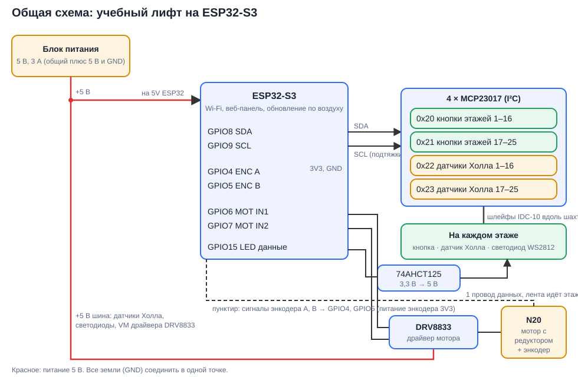
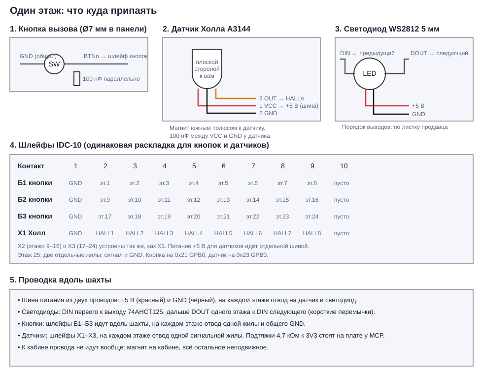

# Подключение: что купить и как соединить

Все схемы для навесного монтажа. Рисунки: [общая схема](img/system.svg), [один этаж и шлейфы](img/floor.svg).

## 1. Что купить

| Деталь | Кол-во | Замечания |
|---|---|---|
| ESP32-S3 DevKitC-1 | 1 | любая плата с выведенными GPIO4–9, 11, 15 |
| Мотор N20 с редуктором и магнитным энкодером, 6 В, 100–200 об/мин | 1 | вал Ø3 с лыской (под ваш шкив); энкодер должен работать от 3,3 В |
| Драйвер DRV8833 (модуль) | 1 | питается от 5 В |
| MCP23017, готовые модули GY-MCP23017 | 4 | на каждом отдельный адрес, см. ниже |
| 74AHCT125 или 74HCT245 | 1 | преобразует 3,3 В сигнала ленты в 5 В |
| Датчик Холла A3144 | 25 (+5 запас) | цифровой, с открытым коллектором, питание 5 В |
| Неодимовый магнит 8×3 мм | 2 | один запасной |
| Светодиод WS2812 5 мм (сквозной, «F5») | 25 (+5 запас) | вывод через отверстие Ø5,2 |
| Кнопки под отверстие Ø7 | 25 | замыкающие без фиксации |
| Резисторные сборки SIP-10 4,7 кОм (общая точка) | 3 | подтяжка датчиков Холла к 3,3 В; можно 25 обычных резисторов |
| Резисторы 4,7 кОм | 2 | подтяжки линий I²C |
| Резистор 330–470 Ом | 1 | в линию данных ленты |
| Конденсаторы 100 нФ | 60 | по одному у каждого датчика, у каждой кнопки и на питание |
| Конденсатор 1000 мкФ 10 В | 1 | на шину 5 В |
| Конденсатор 100 мкФ | 1 | на питание DRV8833 |
| Шлейфовый кабель 10 жил и разъёмы IDC-10 | 6 штук | три шлейфа для кнопок, три для датчиков |
| Провода 2 шт. (красный и чёрный) | вдоль шахты | питание +5 В и GND |
| Блок питания 5 В 3 А | 1 | |

## 2. Питание

* Один блок на **5 В / 3 А**. Плюс идёт на: вход 5V платы ESP32-S3, VM драйвера DRV8833, шину датчиков Холла и светодиодов.
* **Все минусы (GND) соедините в одной точке**: блок, плата, драйвер, 74AHCT125, шлейфы, шина.
* Конденсатор 1000 мкФ ставьте на шину 5 В, ближе к началу шины. 100 мкФ на VM драйвера.
* Мотор 6 В работает от 5 В немного медленнее, это нормально. Скорость всё равно задаёт регулятор.
* Яркость светодиодов в вебе по умолчанию 40 %. На полную яркость лента берёт до 1,5 А: блок это выдержит, но запас по питанию тогда небольшой.

## 3. Соединения ESP32-S3

| Куда | Вывод ESP32-S3 | Что подключить |
|---|---|---|
| I²C | GPIO8 (SDA), GPIO9 (SCL) | линии SDA, SCL всех четырёх MCP23017; подтяжка 4,7 кОм от каждой линии к 3V3 |
| Энкодер | GPIO4 (A), GPIO5 (B) | выходы энкодера мотора; питание энкодера **3V3** и GND |
| Мотор | GPIO6 (IN1), GPIO7 (IN2) | входы IN1, IN2 драйвера DRV8833 |
| Светодиоды | GPIO15 | вход A 74AHCT125, выход через резистор 470 Ом к DIN первого светодиода |
| Аварийный стоп (необязательно) | GPIO11 | кнопка на GND, в `config.h` поставьте `HAVE_ESTOP 1` |

### DRV8833
* VM → +5 В, GND → GND.
* nSLEEP (в модулях он обычно подписан SLP или EEP) → 3V3, иначе драйвер спит.
* IN1 → GPIO6, IN2 → GPIO7.
* Мотор подключается к OUT1 и OUT2 (если едет не в ту сторону, поставьте галку «Развернуть мотор» в веб-панели).

### 74AHCT125
* VCC → +5 В, GND → GND.
* Вывод 1 (¬1OE) → GND, 1A → GPIO15, 1Y → резистор 470 Ом → DIN первого светодиода.
* Остальные входы неиспользуемых буферов (2A, 3A, 4A) на GND, а ¬2OE, ¬3OE, ¬4OE на +5 В.

### Четыре модуля MCP23017
У всех питание **3V3**, GND, SDA, SCL. RESET на 3V3.

| Модуль | Перемычки адреса | Адрес | Что на портах |
|---|---|---|---|
| №1 | нет | 0x20 | порт A (A0–A7): кнопки этажей 1–8; порт B (B0–B7): кнопки 9–16 |
| №2 | A0 | 0x21 | порт A: кнопки 17–24; B0: кнопка 25 |
| №3 | A1 | 0x22 | порт A: датчики 1–8; порт B: датчики 9–16 |
| №4 | A0 и A1 | 0x23 | порт A: датчики 17–24; B0: датчик 25 |

Если вы используете голые микросхемы в корпусе DIP-28: GPB0–GPB7 это ножки 1–8, VDD 9, VSS 10, SCL 12, SDA 13, A0–A2 15–17, RESET 18, GPA0–GPA7 ножки 21–28.

Подтяжка датчиков Холла: от каждого входа на модулях №3 и №4 (A0–A7, B0 каждого) резистор 4,7 кОм к 3V3. Удобно взять сборку SIP-10 (общая точка к 3V3).

## 4. Шлейфы вдоль шахты

### Кнопки (модули 0x20 и 0x21)
Каждая кнопка включена между сигнальной жилой этажа и GND. Внутри MCP включена подтяжка к 3,3 В, поэтому кнопка при нажатии замыкает вход на GND.

| Шлейф | Контакт 1 | Контакты 2–9 | Контакт 10 | Куда на плате |
|---|---|---|---|---|
| Б1 | GND | этажи 1–8 | не используется | 0x20, порт A (A0 = этаж 1 … A7 = этаж 8) |
| Б2 | GND | этажи 9–16 | не используется | 0x20, порт B |
| Б3 | GND | этажи 17–24 | не используется | 0x21, порт A |
| этаж 25 | отдельная пара жил: сигнал + GND | | | 0x21, B0 |

### Датчики Холла (модули 0x22 и 0x23)
Шлейфы несут **только сигнал** (контакт 1 = GND, как и у кнопок). Питание +5 В отдельной шиной вдоль шахты.

| Шлейф | Контакт 1 | Контакты 2–9 | Контакт 10 | Куда на плате |
|---|---|---|---|---|
| Х1 | GND | датчики 1–8 | не используется | 0x22, порт A |
| Х2 | GND | датчики 9–16 | не используется | 0x22, порт B |
| Х3 | GND | датчики 17–24 | не используется | 0x23, порт A |
| этаж 25 | отдельная пара жил: сигнал + GND | | | 0x23, B0 |

Датчик A3144 (плоской стороной к себе, ножки вниз): **1 = VCC (+5 В), 2 = GND, 3 = выход**. Выход тянет вниз, когда рядом южный полюс магнита.
У каждого датчика конденсатор 100 нФ между VCC и GND.

### Светодиоды
Цепочка: выход 74AHCT125 → резистор 470 Ом → DIN светодиода этажа 1 → DOUT этажа 1 → DIN этажа 2 → … → этаж 25.
У каждого светодиода +5 В и GND от шины. Порядок выводов у «F5» WS2812 бывает разный: смотрите листок продавца или проверьте прозвонкой.

## 5. Датчики и магнит

* Магнит ставьте на **боковую стенку кабины**, на y ≈ −24 мм, на высоте 15,6 мм выше пола кабины. Тогда на остановке он оказывается напротив боковых ромбовидных окон шахты (нижний ряд z=38).
* Датчик вставляйте **в окно изнутри** или вплотную снаружи, чтобы расстояние до магнита было как можно меньше. Через стенку получается около 12 мм: для A3144 это на пределе, поэтому берите магнит 8×3, а не 5×2.
* Южным полюсом к датчику. Проверка: поднесите магнит к датчику, в веб-панели на странице «Калибровка» должна загореться красная точка. Если точка загорается от другой стороны магнита, отметьте маркером рабочую сторону и клейте магнит именно ею к датчику.
* Датчики одного ряда ставьте с одной стороны шахты (боковое окно на y=−24, левая или правая стенка, но единая для всех этажей).
* Первый этаж: кабина стоит на упорах, и **магнит должен оказаться в центре зоны датчика**. Подвиньте датчик на 1-м этаже по высоте, если красная точка не горит на упорах.

## 6. Порядок пайки и проверки

1. Соберите ESP32 + MCP23017 (все четыре, без шлейфов). Прошейте. В журнале (вкладка «Сервис») не должно быть «расширители отвечают не все». То же самое видно в Serial Monitor (115200).
2. Подключите один датчик Холла и одну кнопку на этаж 1. Нажмите кнопку: в журнале (вкладка «Сервис») появится запись «Вызов с 1 этажа». Поднесите магнит: красная точка на странице «Калибровка».
3. Подключите DRV8833 и мотор. Пока кабина не подвешена, нажмите «Найти 1-й этаж». Мотор должен крутиться шкивом **вниз** (по ходу кабины вниз). Иначе галка «Развернуть мотор». Если лифт сразу сообщает «Едет не туда», отметьте также «Развернуть энкодер» или мотор, пока ошибка не уйдёт.
4. Подвесьте кабину и противовес, ещё раз «Найти 1-й этаж».
5. Допаивайте этажи по одному, проверяя каждый красной точкой на странице «Калибровка».
6. Светодиоды подключайте в последнюю очередь.
7. После сборки: «Калибровать» на странице «Калибровка».

## 7. Что может пойти не так

| Симптом | Причина |
|---|---|
| «Не нашёл первый этаж» | нет сигнала датчика 1-го этажа, мотор едет вверх, или шкив проскальзывает |
| «Не вижу датчик на N этаже» | не сработал датчик N: магнит развёрнут, слишком далеко, обрыв провода |
| «Нет связи с расширителями» | перепутаны SDA/SCL, нет подтяжек, неверные адреса |
| «Потерял счёт этажей» | нитка проскальзывает по шкиву или растянулась; уберите люфт, натяните нитку |
| Светодиоды мерцают | нет общей земли, нет 74AHCT125 или длинные провода данных без резистора |
| Счёт импульсов «плывёт» при обновлении светодиодов | замените библиотеку на FastLED (в Adafruit NeoPixel может быть блокировка прерываний) |
